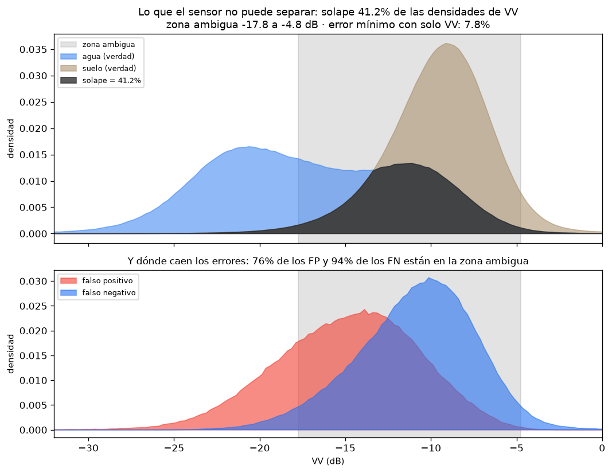
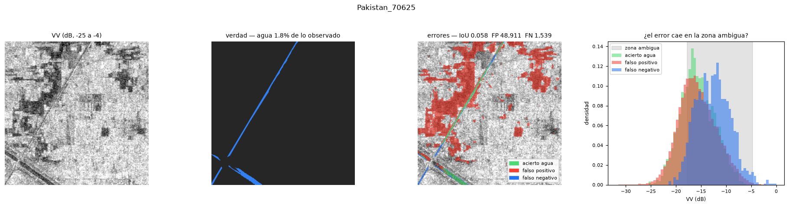

# Paso 7 — Los fallos característicos del SAR (entregable 5)

> El enunciado pide **al menos tres fallos característicos del SAR**. La forma
> fácil de responderlo es elegir tres chips que se ven mal y describirlos. Acá
> se hace otra cosa, porque esa forma fácil no contesta lo único que decide si
> vale la pena seguir entrenando: **si el error es del modelo o del sensor**.

## El resultado en una frase

**El 99.8% de los falsos positivos y el 96.5% de los falsos negativos son
físicamente irresolubles con VV y VH.** Lo que le falta a este modelo no es
capacidad ni datos: es una banda que el radar no tiene.

## Archivos de este paso

| archivo | qué hace |
|---|---|
| [`analizar_fallos.py`](analizar_fallos.py) | mide el solape de las clases en VV y reparte cada error por zona |
| [`figuras_fallos.py`](figuras_fallos.py) | las figuras: el error al lado de la señal que lo explica |

```bash
python pregunta2/paso7_fallos_sar/analizar_fallos.py
python pregunta2/paso7_fallos_sar/analizar_fallos.py --sin-figuras
```

Corre sobre `test` + `bolivia` (105 chips, 23.3 M píxeles observados) con la
corrida `a_solo_dorados`, que es la que produjo los números publicados.

## Por qué el SAR falla, en física

El agua se ve oscura porque una superficie lisa refleja el pulso **lejos** del
satélite — reflexión especular. De ahí salen los dos fallos del sensor:

1. Una superficie **seca y lisa** (asfalto, pista de aeropuerto, arena
   compactada, suelo desnudo) también se ve oscura.
2. Agua **rugosa por viento**, o agua **bajo vegetación** —donde el pulso rebota
   dos veces, tronco-agua, y vuelve amplificado— se ve **brillante**.

Ninguno de los dos es un error de clasificación: son dos superficies distintas
que producen **la misma señal**.

## Cómo se mide, sin suponer nada

Se construyen los histogramas de VV **condicionados a la verdad** —uno para el
agua, uno para el suelo— sobre los 23.3 M de píxeles observados, y se mide
cuánto se solapan.



| | |
|---|---:|
| solape de las densidades de VV | **41.2%** |
| proporción de agua en lo observado | 12.8% |
| zona ambigua (52 bines contiguos) | **−17.75 a −4.75 dB** |
| error de Bayes mirando **solo** VV | **7.81%** |

El error de Bayes usa las proporciones **reales** (el agua es el 12.8% de los
píxeles, no la mitad): es `Σ min(π_agua·p_agua, π_seco·p_seco)`, el error del
mejor clasificador posible que solo viera VV. Dividir el solape por dos lo
habría sobrestimado, porque asume clases equiprobables.

Los histogramas se acumulan en bines de 0.25 dB en vez de guardar valores, así
que entran **todos** los píxeles sin submuestrear.

### Las distribuciones, en una tabla

| categoría | n | VV p5 | mediana | p95 | VH mediana |
|---|---:|---:|---:|---:|---:|
| agua (verdad) | 2 965 705 | −25.6 | **−17.4** | −7.9 | |
| suelo (verdad) | 20 290 118 | −14.9 | **−9.4** | −4.9 | |
| acierto agua (VP) | 2 354 475 | −26.1 | −18.9 | −9.9 | −26.4 |
| acierto seco (VN) | 19 777 726 | −14.6 | −9.4 | −4.9 | −15.6 |
| **falso positivo (FP)** | 512 392 | −21.9 | **−14.6** | −8.4 | −23.4 |
| **falso negativo (FN)** | 611 230 | −17.1 | **−10.6** | −5.6 | −18.6 |

Las dos filas de abajo son el hallazgo: **los falsos positivos se ven como
agua** (mediana −14.6, mucho más oscura que el suelo típico) y **los falsos
negativos se ven como suelo** (mediana −10.6, mucho más brillante que el agua
típica). El modelo no se equivoca contra la evidencia: se equivoca *con* ella.

## Los cuatro modos, con su peso medido



| modo | % de los FP | % de los FN | culpa |
|---|---:|---:|---|
| **1 — solape irreducible**: el error cae en la zona donde las dos clases conviven | 75.5% | 94.0% | sensor |
| **2 — seco y liso se ve como agua**: FP *más oscuro* que la zona ambigua | 24.3% | — | sensor |
| **3 — agua brillante se ve como suelo**: FN *más claro* que la zona ambigua (viento, doble rebote) | — | 2.5% | sensor |
| **4 — error del modelo**: el error cae donde su propia clase domina | **0.2%** | **3.5%** | modelo |
| | | | |
| **atribuible al SENSOR** | **99.8%** | **96.5%** | |
| **atribuible al MODELO** | **0.2%** | **3.5%** | |

El chip de arriba (`Pakistan_70625`, IoU 0.058) es el modo 2 en estado puro: la
verdad es un canal fino y el modelo pinta de rojo los campos oscuros de alrededor.
El cuarto panel muestra por qué: la distribución de los falsos positivos se
superpone casi exactamente con la del agua acertada.

### El quinto eje: agua permanente

`JRCWaterHand` marca agua **permanente** (ríos, lagos) desde fuera del dataset,
así que un falso negativo ahí es otro fallo: una superficie estable, ajena a la
inundación, que el modelo debería tener resuelta.

**Se pierden 7 428 px de 981 901 permanentes (0.8%), el 1.2% de todos los FN.**
No es un problema: el modelo encuentra el agua estable casi siempre, y lo que
falla es el agua nueva.

## La comprobación que valida todo lo anterior

Una cota mal calculada haría que todo el reparto de arriba no signifique nada.
El chequeo:

```
error del modelo (FP+FN sobre observados):  4.83%
cota de Bayes mirando SOLO VV            :  7.81%
```

**El modelo está por debajo de la cota**, que es exactamente lo que tiene que
pasar: recibe VV **y VH** y además ve el **contexto espacial** (una U-Net no
clasifica píxeles sueltos). Si hubiera quedado *por encima* de un umbral sobre
una sola banda, el problema sería del modelo y no habría nada que discutir sobre
el sensor.

## Qué se sigue de esto

1. **Más entrenamiento no va a mover la aguja.** Queda un 0.2% de los FP y un
   3.5% de los FN donde la señal estaba del lado correcto; aun resolviéndolos
   todos, el error baja de 4.83% a ~4.7%.
2. **El bono del entregable 6 —fusionar Sentinel-2— deja de ser un extra y pasa
   a ser el único camino.** Un campo seco y liso y una lámina de agua son
   indistinguibles en VV pero **no** en el infrarrojo cercano, donde el agua
   absorbe casi todo. La fusión no agrega "más datos": agrega la dimensión en la
   que las dos clases sí se separan.
3. **Explica el resultado incómodo del entregable 4.** Que Otsu le gane a la
   U-Net en Bolivia (0.697 contra 0.610) deja de ser raro: si el 94% de los FN
   están en la zona ambigua, lo que decide es dónde se pone el umbral, y Otsu lo
   recalcula **por escena** mientras la U-Net lleva el suyo aprendido de otras
   regiones.

## La sensibilidad a los dos umbrales, medida

La zona ambigua depende del **umbral de dominancia** (0.10) y de la **densidad
mínima por bin** (0.001). Una versión anterior de este README afirmaba que
moverlos cambiaba el peso de los modos 1 a 3 entre sí *"pero no la suma sensor
contra modelo"*. **Eso era una suposición y es falsa**: la suma también se mueve.
El script la barre y la reporta:

| dominancia | densidad mín. | zona ambigua (dB) | FP sensor | FN sensor |
|---:|---:|---|---:|---:|
| 0.02 | 0.0005 | −20.00 a −3.75 | 100.0% | 99.1% |
| 0.05 | 0.0010 | −18.75 a −4.75 | 99.8% | 98.0% |
| **0.10** | **0.0010** | **−17.75 a −4.75** | **99.8%** | **96.5%** |
| 0.20 | 0.0010 | −16.25 a −8.50 | 94.8% | 92.7% |
| **0.30** | 0.0010 | −15.25 a −10.50 | **85.6%** | **88.8%** |

En los 15 ajustes barridos, la atribución al sensor va del **85.6% al 100%** en
los falsos positivos y del **88.8% al 99.1%** en los negativos.

**Lo que no se mueve es la conclusión.** Aun con el ajuste más conservador —el
que exige que una clase tenga el 70% del bin para considerarlo resuelto— **el
86% de los falsos positivos y el 89% de los negativos siguen siendo físicos**. No
hay ningún valor razonable de los umbrales con el que la deuda del modelo pase
de ser marginal.

## Lo que este análisis NO dice

- **No separa viento de vegetación inundada.** Los dos suben la retrodispersión
  y los dos caen en el modo 3; distinguirlos necesitaría una capa de cobertura
  del suelo que este proyecto no tiene. El modo 3 es apenas el 2.5% de los FN,
  así que la distinción no cambiaría ninguna conclusión.
- **No usa un modelo de elevación**, así que la **sombra de radar** detrás de
  terreno abrupto —otro fallo clásico, que también produce píxeles oscuros— no
  se puede separar del modo 2. Queda contada ahí dentro.

